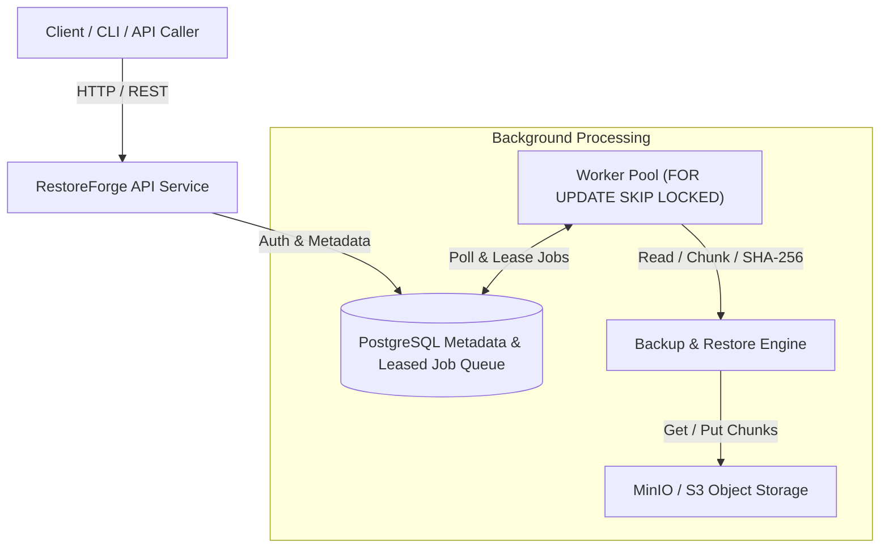

# RestoreForge Architecture

## 1. System Overview

RestoreForge is a multi-tenant, content-addressed backup and disaster recovery platform built for cloud and edge infrastructure.

## 2. Core Components

1. **API Service (`cmd/api`)**: REST API handling tenant auth, backup requests, dataset registration, restore requests, and monitoring.
2. **Worker Engine (`cmd/worker`)**: Concurrency-bounded background workers claiming tasks using PostgreSQL `FOR UPDATE SKIP LOCKED`.
3. **Backup Engine (`internal/backup`)**: Fixed-size chunking, SHA-256 hashing, manifest assembly, deduplication checking.
4. **Restore Engine (`internal/restore`)**: Manifest resolution, chunk retrieval, stream reassembly, file integrity verification.
5. **Storage Layer (`internal/storage`)**: S3-compatible chunk repository.
6. **Repository (`internal/repository`)**: PostgreSQL metadata store managing manifests, job leases, and multi-tenant scoping.
7. **Observability (`internal/observability`)**: Structured logging, Prometheus metrics, and audit event logs.

